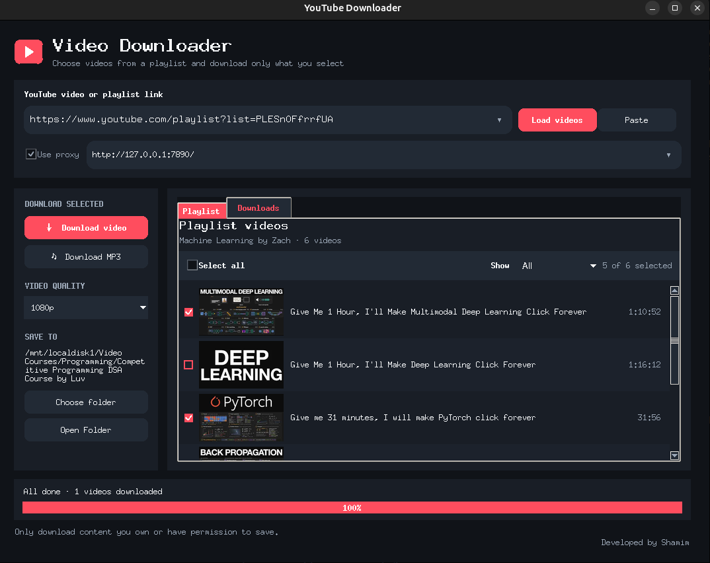

# YouTube Downloader


A lightweight desktop GUI built with Python and Tkinter. It supports YouTube video and playlist links. Load a playlist, select all or individual videos, then use the left-side buttons to download the selected videos as MP4 or MP3. MP4 downloads prefer a single H.264/AAC stream and merge separate streams only when necessary. MP3 output converts YouTube’s supplied audio stream. Video downloads use H.264/AAC streams directly without re-encoding. If YouTube does not offer those codecs at the selected resolution, try a lower quality.

## Windows 11

The app can be built as a standalone Windows executable. Build it on Windows (PyInstaller does not cross-build Windows apps from Linux):

1. Install Python 3.10 or later and [uv](https://docs.astral.sh/uv/).
2. Install FFmpeg and make sure `ffmpeg.exe` is available on your `PATH`. It is needed for MP3 conversion and merging separate streams.
3. Open PowerShell in the project folder and run:

   ```powershell
   .\build_windows.ps1
   ```

4. Run `dist\youtube-downloader.exe`. You can copy the executable elsewhere; settings are saved under `%APPDATA%\youtube-downloader\settings.json`.

The Windows build keeps the Linux build and Debian packaging scripts intact. Windows downloads and playlist features use the same `yt-dlp` backend.

## Install and run with `uv` (recommended)

Install `uv` using the instructions for your Linux distribution at [uv's installation guide](https://docs.astral.sh/uv/getting-started/installation/). Then install the system GUI and media dependencies and launch the app:

```sh
sudo apt install python3-tk ffmpeg
uv sync
uv run python youtube_downloader.py
```

`uv sync` creates `.venv` and installs `yt-dlp` from `pyproject.toml`.

## Install and run with pip

On Debian or Ubuntu:

```sh
sudo apt install python3-tk ffmpeg
python3 -m pip install --user yt-dlp pillow
python3 youtube_downloader.py
```

On Fedora, install `python3-tkinter` and `ffmpeg`, then install `yt-dlp` with pip. Other distributions may use different package names.


## Build installable apps

The installable app is built for Linux.

### Linux

```sh
sudo apt install python3-tk ffmpeg
uv sync
chmod +x build_linux.sh install_linux.sh uninstall.sh
./build_linux.sh
./install_linux.sh
```

The installer copies the executable to `~/.local/bin` and adds it to the desktop application menu. FFmpeg is used for MP3 conversion and for merging separate video/audio streams.

To build a Debian package for Ubuntu or Debian, install the packaging tools and run:

```sh
sudo apt install dpkg-dev
chmod +x build_deb.sh
./build_deb.sh
sudo apt install ./*.deb
```

The `.deb` installs the app and its desktop icon system-wide. APT also installs FFmpeg, which is required for MP3 conversion and merging separate streams. Remove it with `sudo apt remove youtube-downloader`.

## Install or uninstall the packaged app

### Linux

After building the executable, install it and add it to the applications menu:

```sh
./install_linux.sh
```

To uninstall the app and remove its menu entry and icon:

```sh
./uninstall.sh
```

This leaves the project files and build output in place. It does not remove FFmpeg, which may be used by other apps.

Only download videos you own or have permission to save, and follow the applicable laws and YouTube terms.
